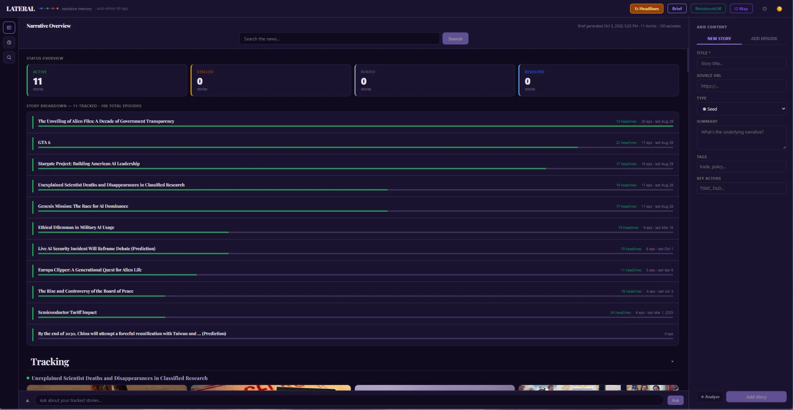
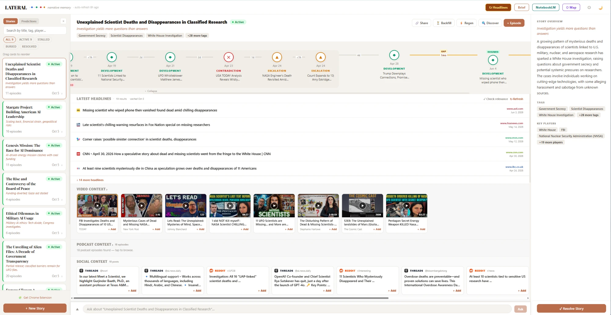
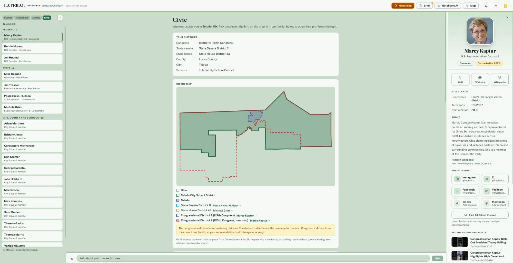

# Lateral — narrative memory

## Why

News is built to be forgotten. Each story arrives as if it had no past: a headline, a burst of coverage, then the next thing. Months later you remember that something happened (a lawsuit, a recall, a promise from someone in power) but not how it ended, or whether it ended at all.

Feeds don't help. They rank what's new, not what's unfinished. Search finds articles, not arcs.

Lateral is for the stories you don't want to lose track of. You tell it what you're following, and it keeps the timeline, gathers new coverage, tells you when something moves, and saves readable copies so the record survives dead links. When you think you know where a story is heading, you can write that down as a prediction and watch the evidence build for or against it, then keep score of how often you were right.

It runs on your own machine — a single-page app (`index.html`) plus a small Node server — and uses [Ollama](https://ollama.com) for the AI parts. Cloud LLM providers are optional. Your stories, notes and predictions stay where you put them.

## Screenshots



*The home overview (Midnight theme): every tracked story at a glance, with the latest coverage for each below. Three themes — Beige, Ledger, Midnight — in Settings → Basic, or press `t` to cycle.*



*A story page: the episode timeline, the latest headlines (with the relevance filter's **Check relevance** button), and video, podcast and social context.*



*Civic: who represents you, with a district map and a full profile for each official.*

## What it does

**Stories that keep their past.** Track a story and Lateral keeps its timeline: episodes, headlines, video and podcast context, intelligence briefs, a connection map, shareable pages. A home feed by category and per-story Discover search with AI-generated queries find what's new. One announcement carried by four outlets shows once, with **+N outlets** — same-story grouping (headline wording, plus embeddings if available, judged by the local model, leaning cautious) counts it as one piece of evidence, not four.

**Predictions you can score.** Write a falsifiable claim, attach *signals* (searches that watch for evidence), and Lateral finds articles and scores each as supporting, contradicting, complicating, or irrelevant — with per-article overrides and re-scoring. The **evidence balance** shows which way the news leans. It is *not* a probability, and it never changes your own confidence. A **market witness** shows live Polymarket and Kalshi odds next to the evidence balance. When a prediction settles, record the outcome; Lateral keeps a **track record** with a Brier score (an anecdote until you have ten or more).

**A relevance filter that shows its work.** Keyword search drags in junk ("military duty" in a football story). A local model reads each article against the topic and moves off-topic ones into a **Filtered out** list you can review and restore. Nothing is silently deleted.

**Civic: who represents you.** Open the **Civic** tab (or press `c`) and enter one street address. Lateral finds your congressional, state senate and state house districts, your school district and the people who hold those seats — email, phone, website wherever a free public source has them — with seats up for election flagged. Your address goes only to the Census Bureau and is **never saved**. From there: **Local news** about the governments that represent you (city and county first), **Local media** (papers, TV, radio found via Wikipedia/Wikidata, plus your own), **Boards and agendas** (Legistar, Granicus, feeds), **watches** that turn council business, bills and federal rules into tracked stories, one-click **bill tracking** that settles a prediction from the official record, **voting dates and your ballot** (with a free Google Civic key), and a **city calendar** of votes, deadlines, meetings and terms — plus your own events, typed in plain words ("2 for 1 tacos at Carnales every Tuesday"), with a subscribable `.ics` for your phone.

**Podcasts with key moments.** Podcast Context searches Apple Podcasts (plus Podcast Index or Listen Notes with your keys) and a local model ranks every episode against your story, tucking the weak ones away. **Transcribe** turns an episode into a searchable, timestamped transcript on your own computer (Whisper, via a small helper), and **Key moments** finds the passages actually about the story so you can play from there.

**A library that survives dead links.** Lateral keeps readable text copies of the articles you track, browsable and full-text searchable in the **Library** (press `l`). The Library can also generate local audio narration of saved articles.

**Alerts, feeds, and "For you".** The **Activity** inbox (the bell, or press `a`) lists what moved: evidence changing direction, resolution dates approaching, new coverage, setup problems. Get the important ones instantly via ntfy, Discord, Slack, email or webhook — with **quiet hours** and **per-story mute** — and everything else as a daily digest. **RSS and Atom work both ways**: subscribe to your Activity, your stories, or a quiet *prediction flips* feed from any reader; point Lateral at a site's feed and its items join the story. The top of Home gathers it all into **For you**: what moved, what's coming up, today's podcast picks, civic happenings.

**Export.** Stories leave Lateral as a print-ready **PDF**, a single **Markdown** file, or an **Obsidian vault** of linked notes — with saved article text, podcast key moments and transcripts optional. Everything is assembled on your computer.

**Keyboard shortcuts** — `/` search, `h` home, `n` new story, `p` new prediction, `l` library, `c` civic, `a` activity, `,` settings, `t` theme, `?` for the list.

## Requirements

- **Docker** with Compose v2
- **Ollama** running on the host, with these models:
  ```bash
  ollama pull qwen3:latest     # relevance filter, evidence scoring, query generation, image-fit judge
  ollama pull moondream        # image judge (optional — without it images are accepted unjudged)
  ollama pull nomic-embed-text # same-story grouping (optional — without it grouping relies on headline wording)
  ```
- A **Tavily API key** (a free tier exists): <https://app.tavily.com>. It powers web search for evidence and briefs, and recovers images from pages that block scrapers.

## Quick start

```bash
git clone https://github.com/ragingapathy/lateral.git && cd lateral

# 1. Give SearXNG a private secret (any random string):
#    edit searxng/settings.yml  ->  server.secret_key

# 2. Optional: set keys through the environment (or paste them in the app instead)
cp .env.example .env

# 3. Start everything
docker compose up -d

# 4. Open the app:  http://localhost:8080
```

Then **Settings → Web search** → paste your Tavily key → **Save key**. Lateral runs a test search straight away so you know the key works. The app opens with a fictional sample story so you can see how things look; delete it whenever. **Settings → Status** shows whether Ollama, your models, Tavily and news search are working, with the fix next to anything that isn't — and exports your data to one file (API keys are never included).

## How the pieces fit

| Service | What it does |
|---|---|
| `web` (Caddy) | Serves `index.html`; forwards `/api/lateral/*` and `/v2/*` to the proxy, `/ollama/*` to Ollama on the host. |
| `lateral-proxy` (Node) | News search, the predictions API, the relevance and image pipelines, saved settings, LLM passthrough. Code in `proxy/`. |
| `searxng` | Meta-search used for news results (JSON output enabled in `searxng/settings.yml`). |

## Your data

Everything that belongs to your install lives in `./data` (mounted at `/data` in the proxy container). It starts empty, is created as you use the app, and is **git-ignored**. To back up, copy the folder. To start fresh, stop the stack and empty it.

| File | What it holds |
|---|---|
| `llm-secrets.json` | API keys saved from Settings. **Secret.** |
| `stories.json` / `v2.json` | Tracked stories and episodes; predictions, signals, scored articles. |
| `settings.json` | Preferences (location, refresh interval, …). |
| `cache.json` / `relevance-cache.json` | Cached headlines and briefs (safe to delete); relevance verdicts and restores. |
| `alerts.json` | Alert settings and the Activity inbox. **Treat as secret** (delivery addresses, email password). Not in the Status export. |
| `feeds.json` | Outgoing-feed secret and per-story feed follows. **Secret.** Not in the Status export. |
| `archive/` / `podcasts/` | Saved article copies; transcripts and key moments. Not in the Status export — copy the folders to back them up. |
| `civic*.json` | Civic profile (district numbers, city/state — never your street address), watches, tracked bills, ballot, media, boards, calendar. Not in the Status export. |
| `foryou.json` | Today's podcast picks, rebuilt daily. |
| `image-cache.json` / `image-stats.json` | Resolved article images; pipeline counters including Tavily Extract usage. |
| `*.log`, `refresh-log.json` | Operational logs and bookkeeping. |

## Configuration

Set on the `lateral-proxy` service in `docker-compose.yml`:

| Variable | Default | Purpose |
|---|---|---|
| `OLLAMA_BASE_URL` | `http://host.docker.internal:11434` | Where the proxy reaches Ollama. |
| `SEARXNG_URL` | `http://searxng:8080` | News search backend. |
| `TAVILY_API_KEY` | — | Optional; a key saved in Settings takes priority. |
| `LATERAL_SCORING_MODEL` | `qwen3:latest` | Evidence scoring. |
| `LATERAL_RELEVANCE_MODEL` | `qwen3:latest` | Relevance judge. |
| `LATERAL_VISION_MODEL` | `moondream:latest` | Describes candidate images. |
| `LATERAL_DEDUPE_MODEL` | the relevance model | Judges whether two articles report the same story. |
| `LATERAL_EMBED_MODEL` | `nomic-embed-text` | Optional; proposes candidate duplicate pairs. |
| `LATERAL_IMAGE_JUDGE_MODEL` | `qwen3:latest` | Decides photo-vs-logo and headline fit. |
| `LATERAL_TAVILY_EXTRACT_PER_DAY` | `40` | Daily cap on Tavily Extract calls (pages that block direct fetching). |
| `LATERAL_NEWS_ENGINES` | see `proxy/server.js` | Which SearXNG news engines to use. |
| `LATERAL_TRANSCRIBE_URL` / `LATERAL_TRANSCRIBE_TOKEN` | `http://host.docker.internal:3007` / — | Address and shared password of the transcription helper. |
| `LATERAL_DATA_DIR` | `/data` | Where state is stored inside the container. |

## API and automation

The proxy exposes a plain JSON API, so scripts and other tools can drive Lateral without the UI. Highlights below; the full surface follows the same patterns.

**Predictions** — `GET/POST /v2/predictions` (create with `statement`, `confidence`, `resolutionDate`, `signals[]`), `GET/PATCH/DELETE /v2/predictions/:id`, `POST /v2/predictions/:id/search` (background search-and-score; poll `…/search/status`), `POST /v2/signals/suggest`, `GET /v2/links?predictionId=` (articles with stance, weight, reasoning), `POST /v2/links/:id/review` · `/score` (override or re-score), `POST /v2/predictions/:id/group` (same-story grouping), `GET /v2/calibration` (track record; set outcomes via `PATCH` with `{"outcome":"yes"|"no"|null}`).

**Stories and library** — `POST /v2/items` (add an article as evidence), `POST /api/lateral/archive/save` · `/queue` · `/backfill`, `GET /api/lateral/archive/search?q=` · `/list` · `/get?key=` · `/stats`.

**Relevance** — `POST /api/lateral/relevance/check` · `/relevance/override`, `POST /api/lateral/relevance/sweep`.

**Alerts and feeds** — `GET /api/lateral/alerts/events` · `/unread` · `/status`, `GET/POST /api/lateral/alerts/config` (channels: ntfy, Discord, Slack, webhook, `email`; `quiet` hours; secrets masked on the way out), `POST /api/lateral/alerts/mute` · `/unmute`, `/test` · `/digest` · `/check` · `/watch`. Atom feeds at `GET /api/lateral/feed/<secret>/activity.xml` · `/stories.xml` · `/story/<id>.xml` · `/flips.xml` · `/prediction/<id>.xml`, plus `/lateral.opml`. Per-story feed follows: `POST /api/lateral/feeds/preview` · `/subs` · `/subs/remove` · `/fetch` · `/opml`.

**Podcasts** — `POST /api/lateral/podcast/rank` · `/podcast/feedback`, `POST /api/lateral/podcast/transcribe` · `/podcast/status`, `GET /podcast/job?key=` · `/podcast/transcript?key=` · `/podcast/list?storyId=`, `POST /api/lateral/podcast/sections` (key moments). The transcription helper runs outside Docker:
`pip install faster-whisper && python tools/transcribe_worker.py` (see the Podcasts section above for the token setup; `tools/start-worker.sh` / `.ps1`).

**Civic** — `GET /api/lateral/civic/profile`, `POST /civic/lookup {"address": …}` (never stored) · `/civic/refresh` · `/civic/remove`; watches: `GET /api/lateral/civic/watch/list`, `…/watch/items?kind=`; bill tracking: `GET /api/lateral/civic/track/preview?item=`, `POST /api/lateral/civic/track/start` · `/refresh` · `/stop`; ballot: `GET /api/lateral/civic/ballot/status`, `POST /civic/ballot/lookup`; media, boards, offices and calendar under `/api/lateral/civic/media/*`, `/civic/boards/*`, `/civic/office/*`, `/api/lateral/calendar/*` (events plus a subscribable `GET /feed/<token>/calendar.ics`).

**System** — `GET /api/lateral/health/check` (Ollama, models, Tavily, news search, data folder), `GET /api/lateral/backup` · `POST /api/lateral/restore` (with `{"dryRun": true}` preview), `POST /api/lateral/images/resolve`, `GET /api/lateral/foryou` · `POST /foryou/refresh`, `POST /api/lateral/dedupe/headlines`.

A git-ignored `proxy/v2.local.js` may export `route(req, reqUrl, res, ctx)` to add private endpoints.

## Chrome extension

`extension/` clips the page you're reading into a new story or episode. In `chrome://extensions`, enable **Developer mode**, **Load unpacked** the `extension/` folder, and set your Lateral URL in the extension's settings (default `http://localhost:8080`).

## Things to know

- **The evidence balance is a direction, not a probability.** It counts weighted supporting vs. contradicting articles; it knows nothing about base rates, time horizon, or whether several articles describe the same event.
- **Local models vary.** Scores and relevance calls can shift slightly between runs. Overrides and restores are always kept.
- **Google News link resolution** uses an undocumented Google endpoint. If it ever stops working, Lateral falls back gracefully: nothing breaks, but more articles show the fallback card.
- **Tavily usage.** Search and scoring use Tavily Search. Tavily Extract is only for pages that block direct fetching, capped per day; `/api/lateral/images/stats` shows the counters.
- **Privacy.** Everything runs locally. Outbound traffic is: your searches (SearXNG's upstream engines and Tavily), fetching the article pages you track, and any cloud LLM provider *you* configure. Civic adds public services (Census Bureau for your address — never saved — TIGERweb boundaries, `congress-legislators`, `openstates/people`, Legistar, Wikidata/Wikipedia, Congress.gov, Open States, the Federal Register), always fetched by Lateral's server, never your browser. Calendar feeds you add are read directly from your computer; robots.txt is respected, and platforms whose terms forbid copying listings are deliberately not supported.
- **Civic data is only as current as its sources.** Datasets can lag an election, Wikidata is volunteer-edited — use **Re-check officials** periodically and confirm anything important on the official site, which every profile links to.

## Troubleshooting

- **"Tavily API key not configured"** — add it under Settings → Web search.
- **AI features fail / "Ollama unreachable"** — confirm Ollama is running and the models are pulled. On Linux, Ollama may need `OLLAMA_HOST=0.0.0.0` so containers can reach it.
- **News search returns little** — individual SearXNG engines come and go; check `docker compose logs searxng`.
- **"Save a copy" says the site blocks automated readers** — Lateral tries Tavily Extract next (shared daily cap); if that fails, the article isn't saved. Video, audio and social pages are never saved as articles.
- **"The transcription worker is not running"** — `pip install faster-whisper`, then `python tools/transcribe_worker.py` (`tools/start-worker.sh` / `tools/start-worker.ps1` run it in the background). Docker can only reach it if it listens beyond localhost, which needs a password: set `LATERAL_WORKER_TOKEN` on the worker and the same value as `LATERAL_TRANSCRIBE_TOKEN` for the proxy. "Rejected the token" means the two values differ.
- **Podcast ranking says "relevance judge offline"** — Ollama didn't answer; start it and press Refresh.
- **Images missing** — check `moondream` is installed and look at `/api/lateral/images/stats`. Articles with no usable image get the fallback card by design.

## What's new

**v2.5.3 — Agent settings, mobile fixes, PWA support.**

**Latest — Saved-article narration, readable mobile discovery.** The Library generates local audio narration of saved articles; discovery reads better on phones.

**v2.5.2 — For you.** What moved on your stories, what's coming up this week, today's podcast picks, civic happenings — at the top of Home.

**v2.5 — City calendar.** Voting dates, deadlines, council and board meetings, terms of office; local event feeds you add (or Lateral finds on your government websites); your own events typed in plain words; month and agenda layouts; a subscribable calendar file.

**v2.4 — Civic: voting dates and your ballot**, and a clearer local-media menu.

**v2.3.2 — Civic: local news and local media.** Districts, map, local news first, other offices, boards and agendas, watching.

**v2.3.1 — Stricter relevance** for tracked stories, before headlines are stored.

**v2.3 — Podcasts** (ranking, Whisper transcripts, key moments), **Export** (PDF, Markdown, Obsidian vault), grouped headlines, quiet hours, per-story mute, email alerts, prediction-flips feed.

**v2.2 — Civic.** Who represents you, from one address that is never saved; watches; one-click bill tracking.

**v2.1.** Change alerts and the Activity inbox, RSS/Atom in and out, same-story grouping, saved copies and the Library, market witnesses (Polymarket and Kalshi).

**v2.0.** The rebuild: predictions with signals and an evidence balance, the relevance filter, the image pipeline, track record, setup check, data export, keyboard shortcuts, a standalone Docker stack.

## License

Lateral is **source-available** under the [PolyForm Noncommercial License 1.0.0](https://polyformproject.org/licenses/noncommercial/1.0.0/). Personal, educational, research and other noncommercial use — modify and share freely. Commercial use needs separate permission. See `LICENSE`.
